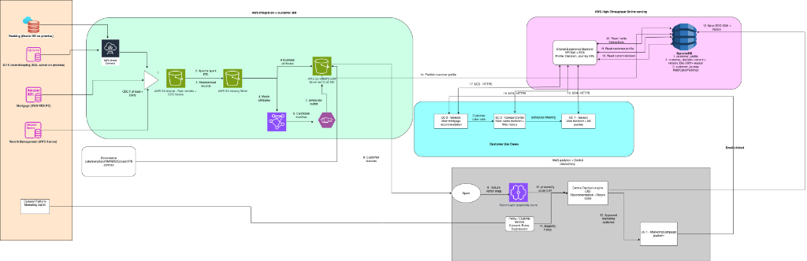

# FinServABC — Customer Experience Architecture

**Pattern:** Batch Customer 360 · Central Decisioning · High-throughput omnichannel serving
**Platform:** Hybrid (on-prem + AWS)

> Source diagram: [`architecture.drawio`](architecture.drawio)

## 1. Goals

1. **UC1 Marketing:** find customers likely to buy a home.
2. **UC2–UC4 Web, Contact Center, Advisor:** give **the same explainable answer** in every channel, with the full cross-channel journey.

## 2. Architecture at a Glance

| Layer | Technology | Role |
|---|---|---|
| Sources | Banking (Oracle, on-prem), 401(k) (SQL Server, on-prem), Mortgage (RDS PostgreSQL), Wealth (Aurora) | Systems of record (unchanged) |
| Ingestion | Direct Connect + AWS DMS | Full load + CDC deltas |
| Customer 360 | S3 Bronze → Iceberg Silver → Iceberg Gold (Spark/Glue) | Raw → standardized → governed |
| Identity | AWS Entity Resolution + MDM | Source IDs → one enterprise customer ID |
| Analytics / ML | Spark features + SageMaker batch | Home-buyer propensity score |
| Decisioning | Decision Engine + Policy/Eligibility (consent, rules, suppression) | One versioned decision with reason codes |
| Serving | DynamoDB (profile, decision, journey) | Fast, customer-keyed reads and writes |
| Access | API Gateway + shared Experience API | **The only way channels get data** |
| Governance | Lake Formation, IAM, KMS, consent, PII controls | Access, privacy, audit |

**Core principle:** decisions are **computed once in batch** and **served to every channel** from one store. Channels never compute answers themselves.

## 3. End-to-End Data Journey: Customer `CUST-123`

| Source | Banking `B1001` · Wealth `W901` · 401(k) `R551` · Mortgage `M221` → **`CUST-123`** |
|---|---|

1. **Ingest (1):** DMS loads the four sources over Direct Connect into **S3 Bronze**: the raw records plus CDC history.
2. **Standardize (2–3):** Spark ETL cleans the data and conforms it into **Iceberg Silver**.
3. **Resolve identity (4–7):** Entity Resolution matches the four source IDs. MDM assigns **`CUST-123`** and writes it to **Gold Customer 360**.
4. **Score (8–10):** Spark builds features: savings +18% over 6 months, mortgage inquiry = Yes. SageMaker scores **0.87**.
5. **Decide (11–12):** The Decision Engine applies consent, eligibility and suppression rules. Result: **`DEC-5001` "Mortgage Consultation"** (model v3, policy v7, reason codes), written to DynamoDB with full history.
6. **UC1 Marketing (13):** The approved, consented audience goes to the campaign platform, and the customer gets the email.
7. **UC2 Web (15–17):** The customer clicks through. The Experience API reads the profile and `DEC-5001`, and the site shows the recommendation and why. The visit is written to the journey record.
8. **UC3 Contact Center (18):** The customer calls later. The agent sees the **same `DEC-5001`**, the reason codes and the web visit, and logs the call outcome.
9. **UC4 Advisor (19–20):** At the meeting, the advisor sees the same decision and the full journey, then starts the application in the Mortgage system.

**Consistency:** every channel reads the same decision ID. **Explainability:** each decision carries its model version, policy version and reason codes.

## 4. Key Decisions: Why This, Not That

| Decision | Chosen | Rejected | Why |
|---|---|---|---|
| Processing model | **Batch + targeted events** | Full streaming (Kappa) | Home-buying signals build over weeks, so daily scoring is enough. Streaming everything adds cost with no benefit. |
| Channel data access | **Shared API over DynamoDB** | Channels query source DBs directly | Protects the financial systems of record from channel load. One access path keeps answers consistent. |
| Recommendation logic | **Central Decision Engine** | Rules in each channel | One version of the truth, versioned and auditable. Channel rules drift apart. |
| Serving store | **DynamoDB** | Aurora + read replicas | Predictable low-latency reads by customer key at scale, without managing replicas or connections. |
| Analytical store | **S3 + Iceberg** | Warehouse only | Cheap history, CDC merges, schema evolution, and compute separated from storage. |
| Identity | **Entity Resolution + MDM** | Joins on email/phone | Persistent IDs, survivorship rules and data stewardship. Email and phone joins are unreliable. |
| ML inference | **SageMaker batch** | Real-time inference | The features are historical aggregates. Real-time scoring would return the same answer. |
| GenAI | **Not in the answer path** (optional phrasing only) | LLM generates answers | Numbers and offers must be deterministic and explainable. |

## 5. Freshness Model

| Tier | What | Latency |
|---|---|---|
| Batch | Customer 360, features, scoring, campaign audience | Daily |
| Near-real-time | Journey events, consent opt-outs, application status | Minutes |
| Real-time | Channel reads from DynamoDB | Milliseconds |

**Extension: fast decision updates.** Example: the customer applies at 9:30 after seeing the recommendation at 9:00.
`Mortgage RDS → DMS CDC → Kinesis → Lambda (map to CUST-123) → EventBridge/SQS → Decision Engine → withdraw DEC-5001`.
This path is asynchronous and needs lag monitoring, decision expiry and fail-safe suppression.

## 6. DynamoDB Model

| Table | Key | Content |
|---|---|---|
| `customer_profile` | `CUSTOMER#CUST-123` | Approved profile + version |
| `customer_decision` | `CUSTOMER#CUST-123` / `CURRENT#HOMEBUYER` · `DECISION#DEC-5001` | Current decision + immutable history |
| `customer_journey` | `CUSTOMER#CUST-123` / `EVENT#ts#id` | Web visits, calls, meetings |

Strongly consistent reads for current decisions · conditional writes · idempotent event processing.

## 7. Assumptions

- Source systems stay the systems of record. Writes, such as a mortgage application, go through source APIs.
- Daily propensity scoring is sufficient. Cross-LOB data use and marketing consent are approved.
- High-volume, low-latency, customer-keyed lookups are required. Peak RPS and RPO/RTO still need business validation.
- Identity can be resolved across LOBs. Low-confidence matches go to stewardship review.

## 8. Summary

**S3/Iceberg** builds the governed Customer 360. **SageMaker** predicts. **The Decision Engine** decides once. **DynamoDB + the Experience API** serve that same decision to Marketing, Web, Contact Center and Advisor, so every channel is consistent, explainable and scalable.
